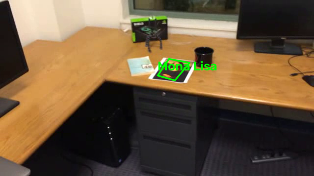

# ЛР2 — Трекинг объекта на видео на основе ключевых точек

**Автор:** Хакимов Илья Александрович, группа Р4222

**Цель работы:** реализовать простейший алгоритм трекинга объекта на видео на основе ключевых точек.

Программа принимает видео, первый кадр которого — крупное изображение плоского прямоугольного объекта. На каждом кадре, где объект виден, вокруг него рисуется рамка с подписью, повторяющая его реальное положение и границы (проективное преобразование эталона).

## 1. Теоретическая база

Положение плоского объекта на кадре описывается **гомографией** $H$ относительно эталона. Общий пайплайн: соответствия точек эталон↔кадр → оценка гомографии → преобразование углов.

- **Ключевые точки**: Shi-Tomasi (`goodFeaturesToTrack`) для слежения, SIFT (`SIFT_create`) для сопоставления с эталоном.
- **Оптический поток Lucas–Kanade** (`calcOpticalFlowPyrLK`): сопровождение точек между кадрами; пирамидальная реализация + forward-backward проверка.
- **Гомография** (`findHomography` + **RANSAC**): устойчивая оценка по соответствиям, inliers — согласованные с моделью точки.
- **Два подхода**: детекция по эталону (SIFT, восстанавливается после потери, но деградирует при отдалении) и трекинг по кадрам (LK, устойчив к плавным большим изменениям масштаба, но дрейфует). В работе — **гибрид**.

## 2. Описание разработанной системы

Реализованы два трекера и общий конвейер (`tracker.py`):

- **`FeatureTracker`** (baseline): SIFT + BFMatcher + ratio test → RANSAC-гомография; мультимасштабный эталон (1.0, 0.5, 0.25, 0.15).
- **`LKTracker`** (основной): точки Shi-Tomasi → пирамидальный LK (окно 25×25, 4 уровня) с forward-backward проверкой → RANSAC-гомография **от эталона** (без накопления ошибки). Приёмы:
  - **валидация рамки** (выпуклость, площадь ≥ 0.05% кадра, изменение площади за кадр в пределах 0.4–2.5×);
  - **пере-якоризация** (каждые 8 кадров перевыбор точек внутри рамки, пересчёт эталонных координат через $H^{-1}$) — устраняет дрейф;
  - **восстановление через SIFT** при потере валидной рамки.
- `draw_tracking` (рамка + подпись), `process_video` (цикл, запись видео, метрики). Для собственного видео эталон задаётся областью `ref_crop`.

## 3. Результаты работы и тестирования

Алгоритм протестирован на трёх вариантах тестового видео, образце (`simple_track.avi`) и собственном видео (`stethem.mp4`, книга, 1280×720, 566 кадров).

| Видео | Кадров | Найдено | % | Методы | мс/кадр |
|---|---|---|---|---|---|
| mona-lisa | 557 | 557 | **100.0** | LK | 2.6 |
| mona-lisa-blur | 557 | 556 | **99.8** | LK+SIFT | 2.4 |
| mona-lisa-blur-extra-credit | 557 | 555 | **99.6** | LK+SIFT | 2.8 |
| simple_track (образец) | 556 | 547 | **98.4** | LK+SIFT | 3.5 |
| **stethem (собственное)** | 565 | 565 | **100.0** | LK | 9.2 |

**Сравнение подходов** на `mona-lisa.avi`: SIFT-детекция — 60.5% найденных кадров (провал до 0% при сильном отдалении), LK+SIFT гибрид — 100%.

| Подход | Найдено | % | мс/кадр |
|---|---|---|---|
| SIFT-детекция (baseline) | 337/557 | 60.5 | 23.0 |
| LK + SIFT (гибрид) | 557/557 | 100.0 | 2.6 |

Примеры кадров и выходные видео с рамками — в каталоге `results/`.



## 4. Выводы по работе

1. Гибрид **LK + SIFT** обеспечил 98–100% корректных рамок на всех видео в реальном времени (~3–10 мс/кадр).
2. SIFT-детекция по эталону деградирует при сильном отдалении объекта; LK-трекинг устойчив к плавным большим изменениям масштаба и ракурса.
3. Критически важные приёмы: forward-backward проверка, оценка гомографии от эталона, валидация рамки и пере-якоризация (без неё чистый LK даёт схлопнутую рамку).
4. Ограничение: при длительном полном исчезновении объекта LK-ветка не восстанавливается сама — необходима SIFT-детекция.
5. На собственном видео результат 100% — богатая текстура объекта даёт много устойчивых точек.

## 5. Использованные источники

1. OpenCV — Optical Flow: https://docs.opencv.org/4.x/d4/dee/tutorial_optical_flow.html
2. OpenCV — Feature2D (Shi-Tomasi, SIFT): https://docs.opencv.org/4.x/db/d27/tutorial_py_table_of_contents_feature2d.html
3. OpenCV — Feature Matching + Homography: https://docs.opencv.org/4.x/d1/de0/tutorial_py_feature_homography.html
4. Lucas B. D., Kanade T. An Iterative Image Registration Technique. IJCAI, 1981.
5. Lowe D. G. Distinctive Image Features from Scale-Invariant Keypoints. IJCV, 2004.
6. Fischler M. A., Bolles R. C. Random Sample Consensus (RANSAC). CACM, 1981.
7. Hartley R., Zisserman A. Multiple View Geometry in Computer Vision. CUP, 2004.

## Структура репозитория

```
├── LR2_Tracking.ipynb   # ноутбук с полным отчётом (Google Colab / Jupyter)
├── tracker.py           # исходный код трекеров
├── videos/              # исходные видео (3 тестовых + образец + собственное)
└── results/             # выходные видео с рамками, кадры, метрики
```

## Запуск

```bash
pip install numpy opencv-python-headless matplotlib
# открыть LR2_Tracking.ipynb и выполнить все ячейки
# (видео ожидаются в ./videos, результаты пишутся в ./results)
```
